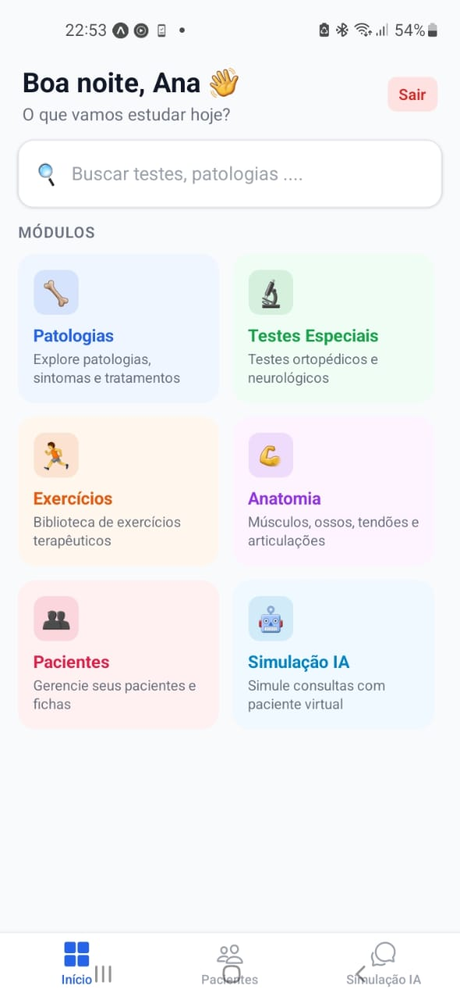
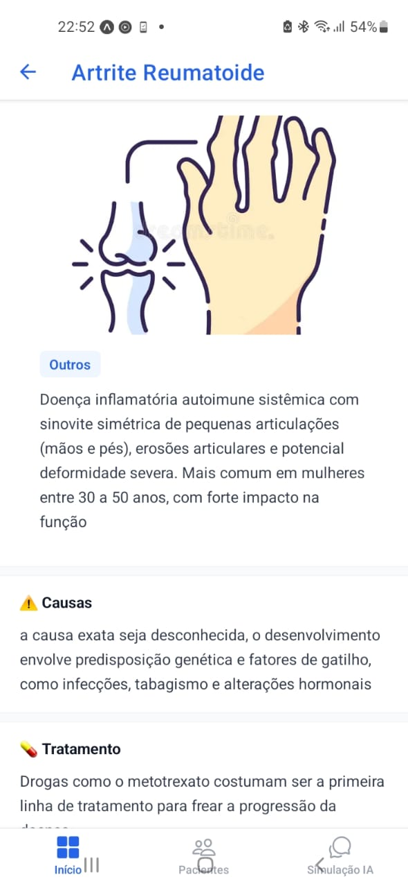
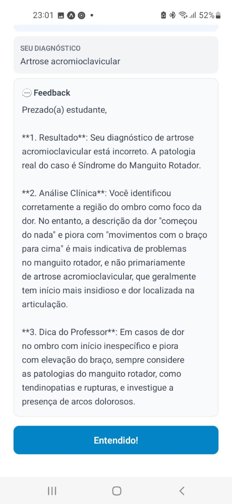

# FisioApp

Plataforma de estudos e gestão clínica para fisioterapeutas, desenvolvida com Django REST Framework no backend e React Native com Expo no frontend. Inclui um simulador de consultas com **paciente virtual e avaliação de diagnóstico por IA** (OpenAI), construído com uma arquitetura em camadas, testada e observável.

---

## Screenshots



---

## Funcionalidades

### Conteúdo Clínico
- **Patologias** Descrição, causas, tratamento, sintomas em chips, testes e exercícios relacionados com navegação direta
- **Testes Especiais** Descrição detalhada, como realizar, achados positivos/negativos, sensibilidade e especificidade
- **Exercícios** Biblioteca terapêutica com nível, categoria, séries, repetições e músculo alvo
- **Anatomia** 5 categorias: músculos, tendões, ligamentos, ossos e articulações, com origem, inserção, função e inervação
- Busca e filtros por região/categoria em todos os módulos
- Imagens armazenadas via **Cloudinary CDN**

### 👥 Gestão de Pacientes
- Cadastro completo com dados pessoais e contato
- **Ficha de anamnese** clínica queixa principal, história da doença, avaliação da dor (escala 0-10), antecedentes, hábitos, dados clínicos (IMC calculado automaticamente)
- **Histórico de sessões** registro de procedimentos, evolução e intensidade de dor por sessão

### Simulação de Consulta com IA
- Ao criar a simulação, o **servidor sorteia uma patologia** do banco: o fisioterapeuta não sabe qual é, e ela só é revelada depois que o diagnóstico é submetido
- **3 níveis de dificuldade**: Fácil, Médio e Difícil
- Um **paciente virtual** (OpenAI) responde às perguntas do fisioterapeuta em um chat livre
- **Memória clínica:** em conversas longas, o sistema resume os fatos que o paciente já declarou (lado, duração, intensidade etc.) para que ele não se contradiga
- Ao submeter o diagnóstico, a IA devolve uma **avaliação estruturada e validada**, com feedback pedagógico em 3 tópicos:
  - Resultado (acertou, ficou próximo ou errou)
  - Análise Clínica (o que identificou corretamente e o que deixou passar)
  - Dica do Professor (orientação clínica sobre a patologia)

---

## Arquitetura da IA

A integração com LLMs foi refatorada em camadas, para que a API web não dependa de nenhum SDK de IA:

```text
React Native ─► View / Serializer (DRF)
                      │
                      ▼
                Casos de uso  ──► InteractionTracker (reserva + estado)
                      │
                      ▼
                Camada de IA
                 ├─ ContextBuilder + ClinicalSummarizer
                 ├─ Prompts + validação de entrada
                 └─ AIProvider (Protocol) ─► OpenAIProvider
```

Destaques:

- **Provedor trocável:** o núcleo depende de um contrato (`Protocol`); trocar de provedor é escrever um novo adaptador.
- **Contexto controlado:** histórico completo no banco, mas ao modelo vão só as mensagens recentes (limitadas por orçamento de tokens) mais o resumo clínico.
- **Respostas estruturadas:** a avaliação do diagnóstico é validada por schema (Pydantic); se a IA falha, nada é finalizado e o aluno pode tentar de novo.
- **Consistência:** uma interação por vez por simulação (restrição única parcial no banco) e gravação atômica da conversa. Nunca fica mensagem sem resposta.
- **Segurança:** a patologia nunca é exposta pela API; entradas do usuário são tratadas como dados (proteção contra *prompt injection*); limites de tamanho e de requisições por minuto; erros internos nunca vazam para o cliente.
- **Observabilidade:** logs estruturados em JSON (sem conteúdo das conversas), registro de cada chamada (duração, tokens, erro) e um comando de métricas.

Detalhes, diagramas e decisões de design em [`docs/arquitetura-ia.md`](docs/arquitetura-ia.md).

---

##  Stack Tecnológica

### Backend
| Tecnologia | Uso |
|---|---|
| Python 3.12+ (desenvolvido com 3.13) | Linguagem principal |
| Django 6 | Framework web |
| Django REST Framework | API REST |
| Simple JWT | Autenticação via tokens |
| django-cors-headers | CORS para o app mobile |
| Cloudinary | Armazenamento de imagens em nuvem |
| OpenAI (Responses API) | IA para simulação de pacientes e avaliação de diagnósticos (modelo configurável) |
| Pydantic | Validação dos schemas de saída da IA |
| pytest + pytest-django | Testes automatizados |
| PostgreSQL | Banco de dados (produção) |
| SQLite | Banco de dados (desenvolvimento) |

### Frontend
| Tecnologia | Uso |
|---|---|
| React Native | Framework mobile multiplataforma |
| Expo SDK 54 | Toolchain de desenvolvimento |
| React Navigation | Navegação entre telas |
| Axios | Requisições HTTP |
| AsyncStorage | Persistência local do token JWT |

---

## Estrutura do Projeto

```
fisio-app/
├── apps/
│   ├── users/            # usuários e autenticação
│   ├── patologias/       # catálogo de patologias
│   ├── testes/           # testes especiais
│   ├── exercicios/       # biblioteca de exercícios
│   ├── anatomia/         # músculos, tendões, ligamentos, ossos, articulações
│   ├── pacientes/        # pacientes, anamnese e sessões
│   └── consulta_ia/      # simulação de consulta com IA
│       ├── application/  #   casos de uso e controle de interações
│       ├── ai/           #   contrato do provedor, prompts, contexto e adaptador OpenAI
│       ├── domain/       #   exceções internas
│       ├── views/        #   camada HTTP
│       └── tests/        #   unit · integration · evaluation
├── core/                 # settings e configuração do projeto
├── docs/                 # documentação de arquitetura
├── mobile/               # app React Native (Expo)
│   └── src/
│       ├── screens/
│       ├── components/
│       ├── services/
│       ├── context/
│       └── routes/
├── pytest.ini
└── requirements.txt
```

---

## Como rodar localmente

### Pré-requisitos
- Python 3.12+
- Node.js 18+
- Expo Go instalado no celular
- Conta no [Cloudinary](https://cloudinary.com) (de graça)
- Chave da API da [OpenAI](https://platform.openai.com) e o nome de um modelo disponível na sua conta

### Backend

```bash
# Clone o repositório
git clone https://github.com/danieldonizeti/fisio-app
cd fisio-app

# Crie e ative o ambiente virtual
python -m venv venv
venv\Scripts\activate  # Windows
source venv/bin/activate  # Linux/Mac

# Instale as dependências
pip install -r requirements.txt

# Configure as variáveis de ambiente
cp .env.example .env
# Edite o .env com suas chaves

# Rode as migrations
python manage.py migrate

# Crie um superusuário
python manage.py createsuperuser

# Inicie o servidor
python manage.py runserver 0.0.0.0:8000
```

> O simulador precisa de pelo menos uma patologia cadastrada (pelo admin ou pela API) para sortear.

### Frontend

```bash
cd mobile

# Instale as dependências
npm install --legacy-peer-deps

# Arrume a URL da API
# Edite src/services/api.js com o IP da sua máquina

# Inicie o Expo
npx expo start
```

Escaneie o QR code com o **Expo Go** no celular.

---

## Variáveis de Ambiente

Crie um arquivo `.env` na raiz do projeto com base no `.env.example`:

```env
SECRET_KEY=sua-chave-secreta-django
CLOUDINARY_CLOUD_NAME=seu-cloud-name
CLOUDINARY_API_KEY=sua-api-key-cloudinary
CLOUDINARY_API_SECRET=seu-api-secret-cloudinary

# IA (OpenAI)
OPENAI_API_KEY=sua-chave-openai
OPENAI_MODEL=modelo-disponivel-na-sua-conta
OPENAI_TIMEOUT_SECONDS=30
OPENAI_SEND_TEMPERATURE=true

# Limites e comportamento da IA (valores padrão)
AI_CONTEXT_MAX_INPUT_TOKENS=3000
AI_CONTEXT_MAX_MESSAGES=30
AI_MAX_USER_MESSAGE_CHARS=1000
AI_MAX_DIAGNOSIS_CHARS=300
AI_INTERACTION_LEASE_SECONDS=180
```

| Variável | Função |
|---|---|
| `OPENAI_MODEL` | Sem valor padrão, porque os modelos disponíveis variam por conta |
| `OPENAI_SEND_TEMPERATURE` | Use `false` se o seu modelo recusar o parâmetro `temperature` |
| `AI_CONTEXT_MAX_INPUT_TOKENS` / `AI_CONTEXT_MAX_MESSAGES` | Teto do contexto enviado ao modelo a cada turno |
| `AI_MAX_USER_MESSAGE_CHARS` / `AI_MAX_DIAGNOSIS_CHARS` | Tamanho máximo dos textos do aluno |
| `AI_INTERACTION_LEASE_SECONDS` | Tempo após o qual uma chamada de IA travada deixa de bloquear a simulação |

---

## Módulos da API

| Endpoint | Descrição |
|---|---|
| `POST /api/auth/login/` | Autenticação JWT |
| `POST /api/users/` | Cadastro de usuário |
| `GET /api/users/me/` | Perfil do usuário logado |
| `GET /api/patologias/` | Lista de patologias |
| `GET /api/patologias/{id}/` | Detalhe com testes e exercícios |
| `GET /api/teste/` | Lista de testes especiais |
| `GET /api/exercicios/` | Lista de exercícios |
| `GET /api/anatomia/musculos/` | Lista de músculos |
| `GET /api/anatomia/tendoes/` | Lista de tendões |
| `GET /api/anatomia/ligamentos/` | Lista de ligamentos |
| `GET /api/anatomia/ossos/` | Lista de ossos |
| `GET /api/anatomia/articulacoes/` | Lista de articulações |
| `GET /api/pacientes/` | Lista de pacientes do fisioterapeuta |
| `POST /api/pacientes/{id}/anamnese/` | Criar/atualizar anamnese |
| `POST /api/pacientes/{id}/sessoes/` | Registrar sessão |
| `GET /api/consulta-ia/` | Lista as simulações do usuário logado |
| `POST /api/consulta-ia/` | Cria uma simulação (`titulo` e `nivel`); a patologia é sorteada no servidor |
| `GET /api/consulta-ia/{id}/` | Detalhe da simulação |
| `GET /api/consulta-ia/{id}/historico/` | Mensagens da conversa |
| `POST /api/consulta-ia/{id}/enviar-mensagem/` | Chat com o paciente virtual |
| `POST /api/consulta-ia/{id}/submeter-diagnostico/` | Avalia o diagnóstico com IA, finaliza a simulação e revela a patologia |

### Formato de erro e limites (simulador)

Os erros do simulador seguem sempre `{"detail": "<mensagem>", "code": "<código estável>"}`.

| Status | Quando |
|---|---|
| `400` | Texto vazio, não textual ou longo demais; simulação já finalizada |
| `401` | Sem token válido |
| `404` | Simulação inexistente ou de outro usuário |
| `409` | Já existe uma resposta em andamento nesta simulação |
| `429` | Muitas requisições (20/min para mensagens e 5/min para diagnóstico, por padrão) |
| `500` | Falha da IA, sem detalhes internos |
| `503` | Nenhuma patologia cadastrada para sortear |

---

## Testes

```bash
pytest                          # testes de código: rápidos, sem rede, sem custo
pytest -m integration           # adaptador contra a API real da OpenAI (gasta tokens)
pytest -m evaluation -v -s      # avaliação do comportamento do modelo (gasta tokens)
```

| Nível | O que verifica |
|---|---|
| **Padrão** | Fluxos, erros, isolamento entre usuários, concorrência, limites, segurança e higiene dos logs, usando um provedor de IA falso |
| **Integração** | Que o adaptador funciona com a API real |
| **Avaliação** | Que o modelo se comporta bem: o paciente não revela a patologia, o avaliador resiste a tentativas de injeção e julga com coerência, o resumo preserva os fatos da consulta |

Os dois últimos níveis ficam fora da execução padrão e exigem `OPENAI_API_KEY` e `OPENAI_MODEL` configurados.

---

## Métricas da IA

```bash
python manage.py ia_metrics --dias 7
```

Mostra, por tipo de chamada (`mensagem`, `diagnostico`, `resumo`): total, taxa de falha, latência (p50 e p95), tokens consumidos e os códigos de erro mais frequentes. As interações também podem ser inspecionadas, somente leitura, no admin do Django.

---

## Próximos passos

- [x] Refatoração da integração com IA (arquitetura em camadas, OpenAI, testes e observabilidade)
- [ ] Imagens em todos os módulos (patologias, testes, exercícios, anatomia)
- [ ] Módulo de IA Diagnóstica descreve o paciente e a IA sugere diagnósticos prováveis
- [ ] IA sugerindo patologias prováveis através de uma anamnese
- [ ] Histórico de simulações com estatísticas de acertos e evolução
- [ ] Resumo clínico em segundo plano (tarefa assíncrona) para reduzir a latência
- [ ] Cache compartilhado (Redis) para o limite de requisições em produção
- [ ] Deploy

---

## Autor

**Daniel Donizeti**